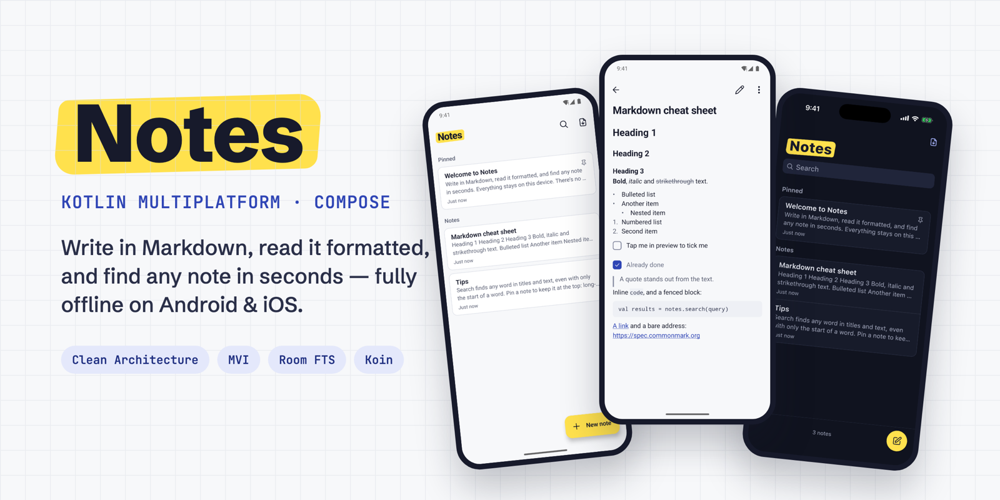

<h1 align="center">𝙽𝚘𝚝𝚎𝚜𝙺𝙼𝙿</h1>

<p align="center">
  <a href="https://kotlinlang.org/"></a>
  <a href="https://www.jetbrains.com/kotlin-multiplatform/"></a>
  <a href="https://www.jetbrains.com/compose-multiplatform/"></a>
  <a href="https://m3.material.io/"></a>
  <br/>
  <a href="https://developer.android.com/kotlin/multiplatform/room"></a>
  <a href="https://insert-koin.io/"></a>
  <a href="https://kotlinlang.org/docs/coroutines-overview.html"></a>
  <a href="https://kotlinlang.org/docs/multiplatform/compose-navigation.html"></a>
  <a href="https://developer.android.com/build/releases/gradle-plugin"></a>
  <br/>
  <a></a>
  <a></a>
  <a></a>
  <a></a>
  <a href="LICENSE"></a>
</p>

<p align="center">𝙰 𝚕𝚘𝚌𝚊𝚕-𝚏𝚒𝚛𝚜𝚝 𝙼𝚊𝚛𝚔𝚍𝚘𝚠𝚗 𝚗𝚘𝚝𝚎𝚜 𝚊𝚙𝚙 𝚏𝚘𝚛 𝙰𝚗𝚍𝚛𝚘𝚒𝚍 𝚊𝚗𝚍 𝚒𝙾𝚂, 𝚋𝚞𝚒𝚕𝚝 𝚏𝚛𝚘𝚖 𝚘𝚗𝚎 𝙺𝚘𝚝𝚕𝚒𝚗 𝙼𝚞𝚕𝚝𝚒𝚙𝚕𝚊𝚝𝚏𝚘𝚛𝚖 𝚊𝚗𝚍 𝙲𝚘𝚖𝚙𝚘𝚜𝚎 𝙼𝚞𝚕𝚝𝚒𝚙𝚕𝚊𝚝𝚏𝚘𝚛𝚖 𝚌𝚘𝚍𝚎𝚋𝚊𝚜𝚎. 𝚆𝚛𝚒𝚝𝚎 𝚒𝚗 𝙼𝚊𝚛𝚔𝚍𝚘𝚠𝚗, 𝚛𝚎𝚊𝚍 𝚒𝚝 𝚏𝚘𝚛𝚖𝚊𝚝𝚝𝚎𝚍, 𝚊𝚗𝚍 𝚏𝚒𝚗𝚍 𝚊𝚗𝚢 𝚗𝚘𝚝𝚎 𝚒𝚗 𝚜𝚎𝚌𝚘𝚗𝚍𝚜. 𝙽𝚘 𝚊𝚌𝚌𝚘𝚞𝚗𝚝, 𝚗𝚘 𝚜𝚎𝚛𝚟𝚎𝚛, 𝚗𝚘 𝚜𝚢𝚗𝚌: 𝚎𝚟𝚎𝚛𝚢 𝚗𝚘𝚝𝚎 𝚕𝚒𝚟𝚎𝚜 𝚘𝚗 𝚝𝚑𝚎 𝚍𝚎𝚟𝚒𝚌𝚎.</p>
</br>

## **`𝚂𝚗𝚊𝚙𝚜𝚑𝚘𝚝𝚜`** 📱

<p align="center"><b>Android</b>, light theme</p>

| Notes list | Preview | Editor | Search | Actions |
| :---: | :---: | :---: | :---: | :---: |
| 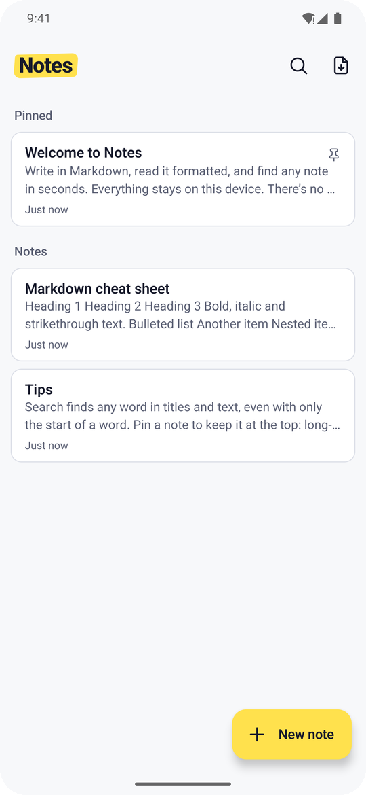 | 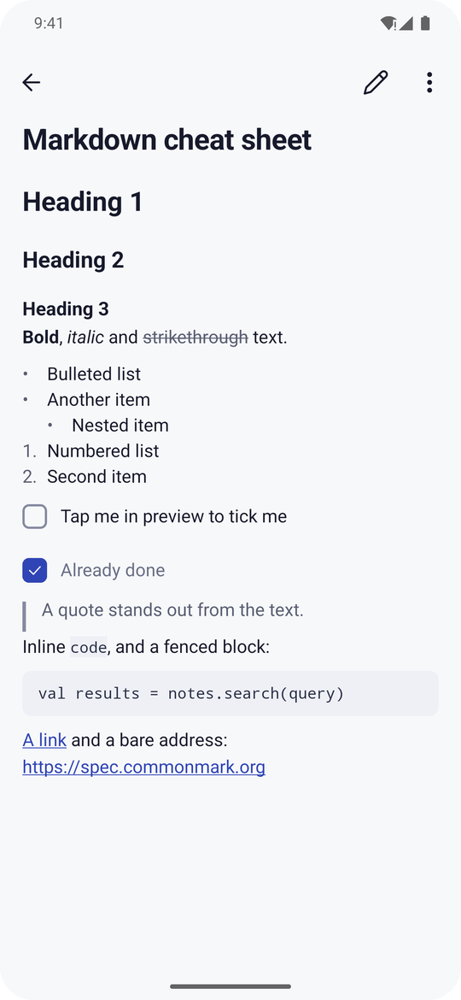 | 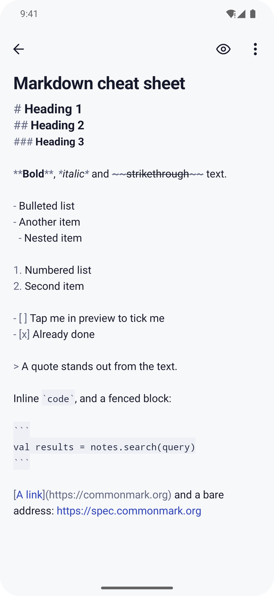 | 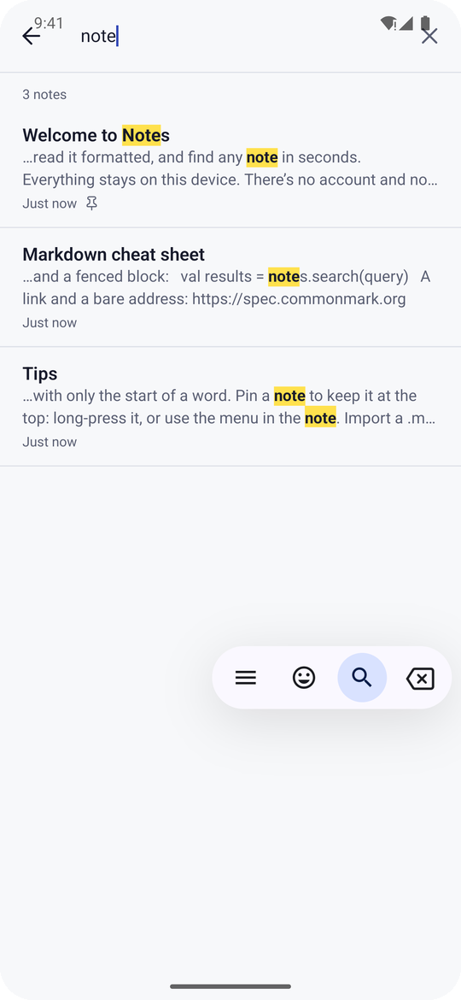 | 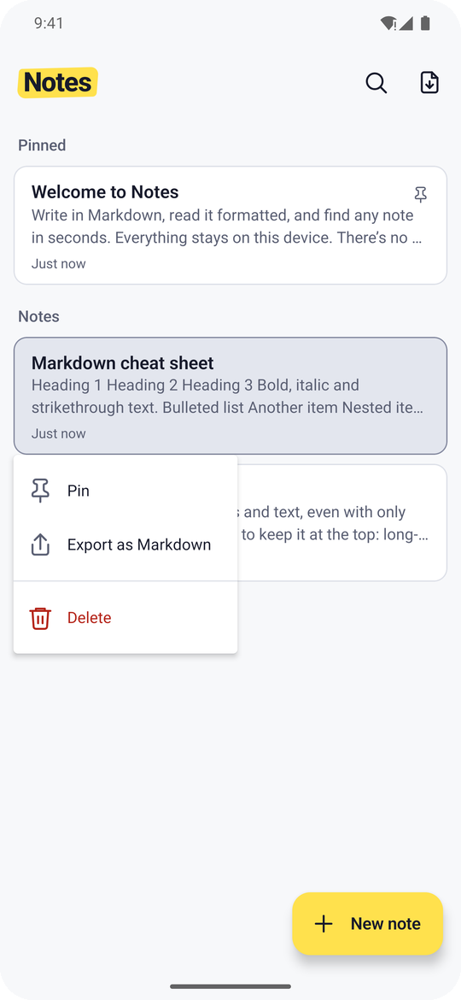 |

<p align="center"><b>Android</b>, dark theme</p>

| Notes list | Preview | Editor | Search | Delete dialog |
| :---: | :---: | :---: | :---: | :---: |
| 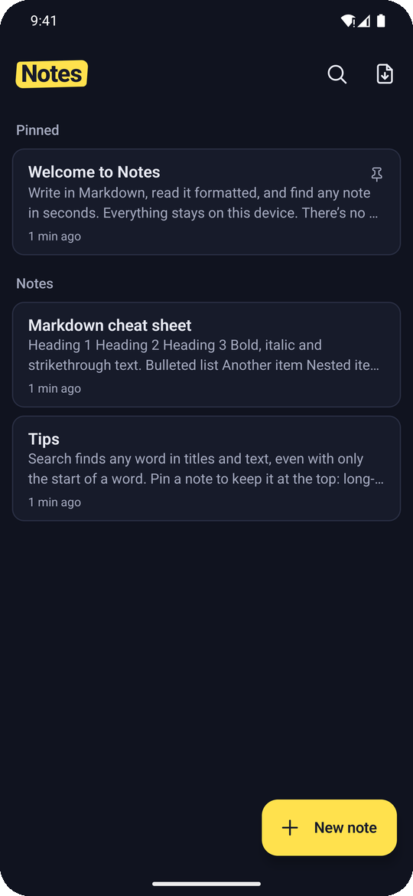 | 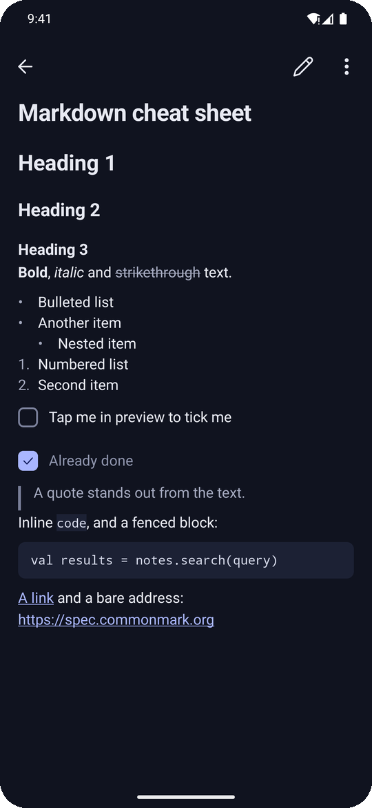 | 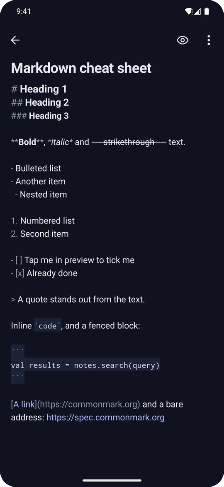 | 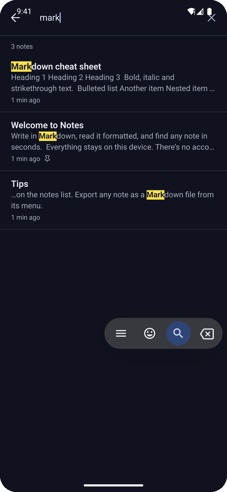 | 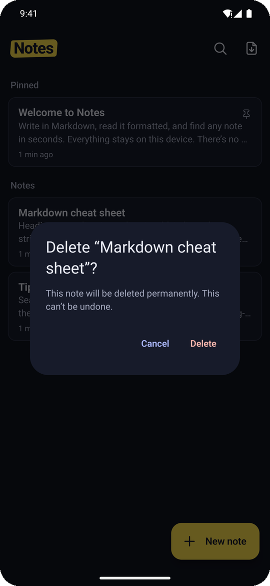 |

<p align="center"><b>iOS</b>, the same shared UI following iOS conventions (search field, toolbar create button)</p>

| Light | Dark |
| :---: | :---: |
| 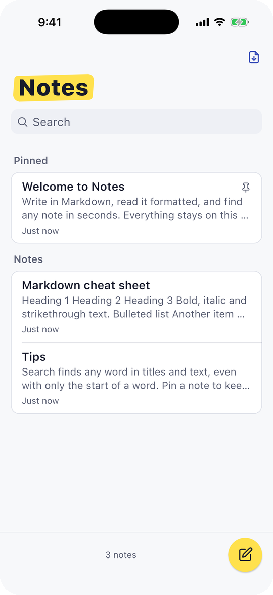 | 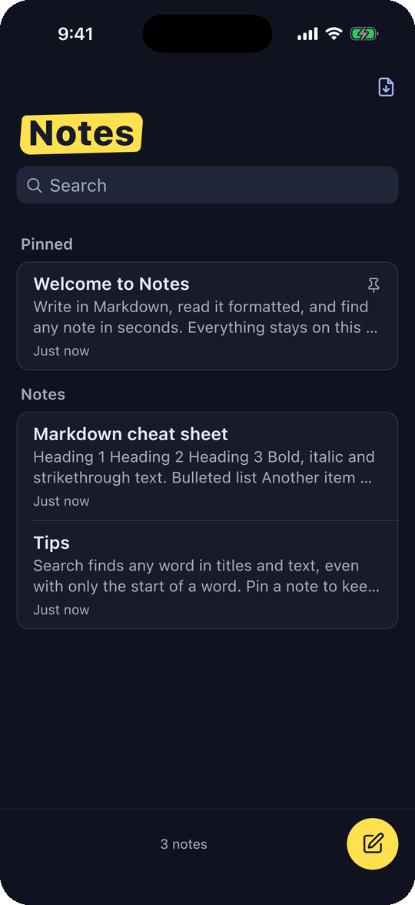 |

## **`𝙸𝚗𝚝𝚛𝚘𝚍𝚞𝚌𝚝𝚒𝚘𝚗`** 💡

:label: Markdown is a fast, portable way to write, but many notes apps hide it behind rich-text editors or bury it under features. **Notes** keeps only the core: write in Markdown, read it formatted, and find any note in seconds.</br>
:label: Everything is shared: domain logic, data layer, ViewModels, **and the UI**. The Android and iOS apps are thin shells that host the same Compose Multiplatform screens, and each platform still gets its own conventions where users expect them.</br>
:label: The project is also an experiment in **agentic, spec-driven development**: a written [feature specification](Code/requirements/notes-feature-specification.md), [HTML designs](Code/design/index.html), and an [`AGENTS.md`](Code/AGENTS.md) system prompt with [project skills](Code/.claude/skills) drive what gets built and how.

### **`𝙿𝚛𝚒𝚗𝚌𝚒𝚙𝚕𝚎𝚜`** :card_index_dividers:

| Principle | What it means in the app |
| --- | --- |
| ✍️ **Writing comes first** | Opening the app and starting a note takes one tap. Nothing asks you to organize before you write. |
| 🔤 **Formatting lives in the text** | Formatting is typed as Markdown and stored **exactly as typed**, never rewritten or normalized. |
| 🔒 **You own your data** | Fully offline. No network permission, analytics, or tracking. Notes leave the device only when you export them. |
| 💾 **Never lose a word** | Autosave debounced at 500 ms, flushed when the screen leaves the foreground; drafts survive process death via `SavedStateHandle`. |
| ⚡ **Fast feels calm** | Database, file, and Markdown work runs off the main thread. Search updates in ≤ 100 ms with 10,000 notes. |
| ♿ **Usable by everyone** | Accessible names and roles, 48 dp / 44 pt touch targets, 200 % text scaling, reduce-motion, RTL, and WCAG 2.2 AA contrast. |

## **`𝙵𝚎𝚊𝚝𝚞𝚛𝚎𝚜`** 📻

| `𝙵𝙴𝙰𝚃𝚄𝚁𝙴` | `𝙳𝙴𝚂𝙲𝚁𝙸𝙿𝚃𝙸𝙾𝙽` |
| --- | --- |
| **Notes list** | Pinned notes on top, then everything by last edited. Title, Markdown-free preview, and relative time on each entry. Long-press for Pin, Export, or Delete. |
| **Markdown editor** | Raw Markdown with light syntax highlighting (muted markers), a formatting toolbar above the keyboard, and list continuation for `-`, `1.`, `- [ ]`, and `>`. |
| **Preview mode** | Formatted reading view with headings, lists, quotes, code blocks, **tickable checklists**, and links that open in the system browser. |
| **Full-text search** | Room **FTS4** index over titles and bodies: prefix matching, AND across words, diacritic-insensitive, with matches highlighted by background **and** bold. |
| **Pin notes** | Keep important notes on top from the list or from the note's menu. |
| **Import** | Pick a single `.md` / `.txt` file. UTF-8 with BOM handling, line endings normalized, and a 5 MB limit. |
| **Export** | Share or save any note as a `.md` file with a sanitized, cross-platform file name. |
| **Safe by default** | Imported content is untrusted: raw HTML is never rendered, and only `http`, `https`, and `mailto` links open. |
| **Light and dark** | Theme follows the system, with a custom palette (paper, ink, cobalt, marker, graphite) mapped from design tokens. |
| **Sample notes** | First launch seeds a welcome note, a Markdown cheat sheet, and tips. |

## **`𝚃𝚎𝚌𝚑 𝚜𝚝𝚊𝚌𝚔`** 🧰

| `𝙻𝙸𝙱𝚁𝙰𝚁𝚈` | `𝙿𝚄𝚁𝙿𝙾𝚂𝙴` |
| --- | --- |
| [Kotlin Multiplatform](https://www.jetbrains.com/kotlin-multiplatform/) | One codebase for Android (`minSdk 24`, `targetSdk 37`) and iOS (`iosArm64`, `iosSimulatorArm64`) |
| [Compose Multiplatform](https://www.jetbrains.com/compose-multiplatform/) + Material 3 | Shared declarative UI on both platforms |
| [Room KMP](https://developer.android.com/kotlin/multiplatform/room) + bundled SQLite | Local database with an FTS4 search index |
| [Koin](https://insert-koin.io/) | Dependency injection, ViewModel injection with `koinViewModel()` |
| [Navigation Compose (JetBrains)](https://kotlinlang.org/docs/multiplatform/compose-navigation.html) | Type-safe routes with `kotlinx.serialization` |
| [Lifecycle ViewModel + SavedState](https://kotlinlang.org/docs/multiplatform/compose-viewmodel.html) | MVI ViewModels and process-death restore |
| [Kotlin Coroutines & Flow](https://kotlinlang.org/docs/coroutines-overview.html) | Async work and the database as an observable source of truth |
| [JetBrains Markdown](https://github.com/JetBrains/markdown) | CommonMark/GFM parsing for preview and plain-text previews |
| [kotlinx-datetime](https://github.com/Kotlin/kotlinx-datetime) | Timestamps and relative time formatting |
| [Turbine](https://github.com/cashapp/turbine) · [AssertK](https://github.com/willowtreeapps/assertk) · `kotlin.test` | Unit testing flows and logic in `commonTest` |

## **`𝙰𝚛𝚌𝚑𝚒𝚝𝚎𝚌𝚝𝚞𝚛𝚎`** 🏛️

The app follows **Clean Architecture**, organized **feature-first**, with an **MVI** presentation layer. Dependencies always point inward: `presentation → domain ← data`. The domain layer is pure Kotlin with no platform or framework imports, which keeps all business rules testable on the JVM and on iOS.

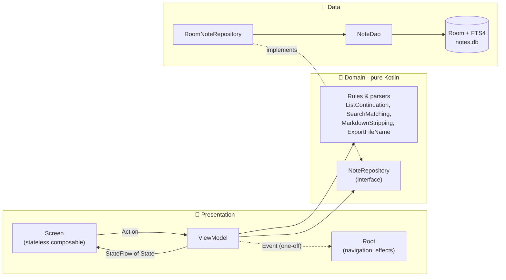

### **`𝙲𝚘𝚖𝚖𝚞𝚗𝚒𝚌𝚊𝚝𝚒𝚘𝚗 𝚋𝚎𝚝𝚠𝚎𝚎𝚗 𝚝𝚑𝚎 𝚕𝚊𝚢𝚎𝚛𝚜`** :card_index_dividers:

| Layer | Responsibility | Key rules |
| --- | --- | --- |
| **Presentation** | Compose screens, ViewModels, `UiText` | Each screen has a `State`, an `Action` sealed interface, an `Event` sealed interface, and a ViewModel exposing `StateFlow<State>`. A `Root` composable wires the ViewModel and navigation; a stateless `Screen` composable stays previewable. |
| **Domain** | Models, repository contracts, business rules | Pure Kotlin. Errors are typed with `Result<T, E>` / `EmptyResult<E>` and `DataError`; nothing throws across a layer boundary. |
| **Data** | Room entities, DAOs, mappers, repositories | The database is the **single source of truth**; the UI observes it through `Flow`. Repositories return domain models and own the entity mapping. |

### **`𝙼𝚅𝙸 𝚏𝚕𝚘𝚠`** :card_index_dividers:

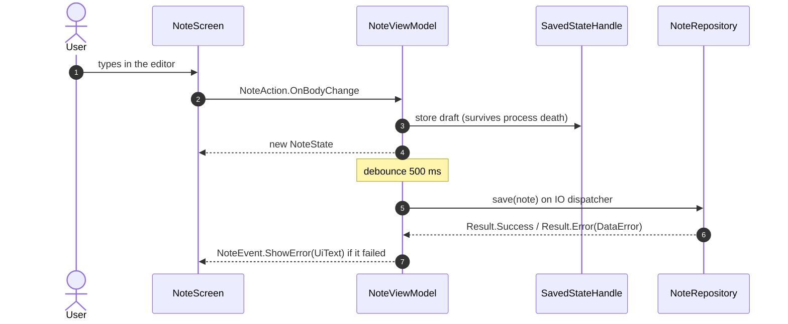

## **`𝙿𝚛𝚘𝚓𝚎𝚌𝚝 𝚜𝚝𝚛𝚞𝚌𝚝𝚞𝚛𝚎`** :package:

The Gradle root lives in [`Code/`](Code). Code is split into **core** modules shared by every feature and **feature** modules that never depend on each other. Each feature is split again into `domain` and `presentation`.

    NotesKMP
    ├── assets/                      ← README banner and screenshots
    └── Code/                        ← Gradle root (run all commands from here)
        ├── androidApp/              ← Thin Android shell: MainActivity, Application, manifest
        ├── iosApp/                  ← Xcode project, SwiftUI entry point hosting the shared UI
        ├── shared/                  ← App assembly: App(), NavHost, Koin startup, MainViewController
        ├── build-logic/
        │   └── convention/          ← Gradle convention plugins (see below)
        ├── core/
        │   ├── domain/              ← Note model, NoteRepository, Result, DataError, search & stripping rules
        │   ├── data/                ← RoomNoteRepository, mappers, platform DI modules
        │   ├── database/            ← Room database, NoteEntity, FTS4 entity, NoteDao, builders
        │   ├── presentation/        ← UiText, ObserveAsEvents, relative time, file picker / share (expect/actual)
        │   ├── designsystem/        ← NotesTheme, color tokens, typography, icons, reusable components
        │   └── testing/             ← Fakes shared by tests: FakeNoteRepository, FakeClock
        ├── feature/
        │   ├── notes/               ← Home: notes list, pin, import, export, delete
        │   │   ├── domain/          ←   MarkdownImport (BOM, line endings, 5 MB limit)
        │   │   └── presentation/    ←   NotesListViewModel, NotesListScreen, navigation
        │   ├── note/                ← Read and write a single note
        │   │   ├── domain/          ←   ListContinuation, MarkdownFormatting, MarkdownSyntax, ChecklistToggle
        │   │   └── presentation/    ←   NoteViewModel, MarkdownEditor, MarkdownPreview
        │   └── search/              ← Full-text search
        │       ├── domain/          ←   SearchSnippet
        │       └── presentation/    ←   SearchViewModel, SearchScreen
        ├── requirements/            ← Feature specification (source of truth for behavior)
        ├── design/                  ← HTML mockups and design tokens (source of truth for looks)
        ├── gradle/libs.versions.toml← Version catalog: every dependency and plugin version
        └── AGENTS.md                ← System prompt for coding agents (CLAUDE.md links to it)

### **`𝙼𝚘𝚍𝚞𝚕𝚎 𝚍𝚎𝚙𝚎𝚗𝚍𝚎𝚗𝚌𝚢 𝚐𝚛𝚊𝚙𝚑`** :card_index_dividers:

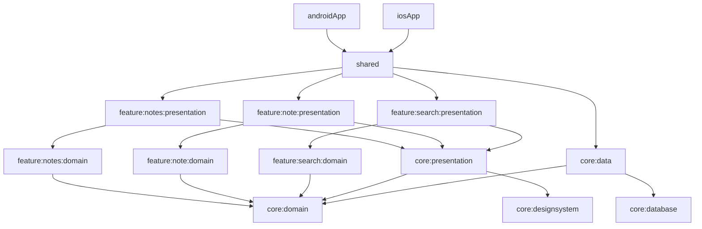

## **`𝚂𝚝𝚛𝚊𝚝𝚎𝚐𝚒𝚎𝚜 𝚞𝚜𝚎𝚍`** 🧭

| `𝚂𝚃𝚁𝙰𝚃𝙴𝙶𝚈` | `𝙷𝙾𝚆 𝙸𝚃 𝙸𝚂 𝙰𝙿𝙿𝙻𝙸𝙴𝙳` |
| --- | --- |
| **Feature-first modularization** | Features are isolated modules that can't see each other; cross-feature navigation goes through callbacks wired in `:shared`. Smaller modules mean clearer ownership and faster incremental builds. |
| **Convention plugins** | [`build-logic`](Code/build-logic/convention) ships `kmpLibrary`, `cmpLibrary`, `cmpFeature`, `cmpApplication`, `room`, and `androidApplicationCompose`, so a module's `build.gradle.kts` is a few lines and Gradle config is never copy-pasted. |
| **Version catalog** | Every dependency and plugin version lives in [`libs.versions.toml`](Code/gradle/libs.versions.toml). Type-safe project accessors (`projects.core.domain`) replace string paths. |
| **Shared UI, native conventions** | One Compose UI. Android gets a FAB, predictive back, and edge-to-edge; iOS gets a search field, a toolbar create button, swipe-back, the native share sheet and file picker, and iOS-style alerts. |
| **`expect`/`actual` only at the edges** | Platform code is limited to real platform APIs: the database builder, file picker, share/save flow, URL opening, and locale-aware time formatting. |
| **Offline-first, single source of truth** | Room is the only source of truth. Screens observe `Flow`s, so a change anywhere (import, pin, delete) updates every screen. |
| **Typed error handling** | `Result<T, E>` with `DataError` instead of exceptions; errors are mapped to `UiText` for localized messages at the edge. |
| **Injected dispatchers** | `AppDispatchers` is injected everywhere, so tests swap in `UnconfinedTestDispatcher` and nothing touches `Dispatchers.Main` directly. |
| **Design tokens to theme** | [`tokens.css`](Code/design/assets/tokens.css) is mapped once into `NotesTheme`; components read colors from the theme, never raw hex. Contrast is verified by unit tests. |
| **Spec-driven, agentic workflow** | `requirements/` defines behavior, `design/` defines appearance, and [`.claude/skills`](Code/.claude/skills) define code structure (MVI, data layer, Koin, navigation, testing). Agents build only what the spec describes. |

## **`𝙳𝚎𝚜𝚒𝚐𝚗 𝚜𝚢𝚜𝚝𝚎𝚖`** 🎨

The palette comes from [`Code/design/assets/tokens.css`](Code/design/assets/tokens.css). Open [`Code/design/index.html`](Code/design/index.html) in a browser to see every screen and component.

| Token | Light | Dark | Used for |
| --- | --- | --- | --- |
| `paper` / `bg` |  `#F7F8FA` |  `#10131F` | App background |
| `ink` / `on-bg` |  `#171A2B` |  `#E7E9F2` | Text |
| `cobalt` / `primary` |  `#2F45B5` |  `#A9B6FF` | Links, checkboxes, focus |
| `marker` / `accent` |  `#FFE14D` |  `#FFE14D` | Wordmark, create button, search highlight |
| `graphite` / `on-muted` |  `#5A5F73` |  `#A4A9BE` | Previews, timestamps |

## **`𝚃𝚎𝚜𝚝𝚒𝚗𝚐`** 🧪

All business logic ships with unit tests in `commonTest`, written with `kotlin.test`, AssertK, and Turbine, using **fakes instead of mocks** and **no I/O** (no disk, database, network, or real clock). The same tests run on the JVM and on the iOS simulator.

| Area | Examples of what is tested |
| --- | --- |
| Domain rules | Fallback titles, Markdown stripping for previews, list continuation, toolbar wrap/unwrap, checklist toggling |
| Search | Diacritic-insensitive, prefix, and AND matching; snippet extraction and highlight ranges |
| Import / export | BOM and line-ending handling, the 5 MB limit, export file-name sanitizing |
| Presentation | `NotesListViewModel`, `NoteViewModel` (autosave, drafts restored from `SavedStateHandle`), `SearchViewModel`, `UiText`, relative time |
| Data | `RoomNoteRepository` against a fake DAO |
| Design system | Theme tokens and WCAG contrast ratios for both themes |

## **`𝙶𝚎𝚝𝚝𝚒𝚗𝚐 𝚜𝚝𝚊𝚛𝚝𝚎𝚍`** 🚀

**Requirements:** a recent Android Studio with the Kotlin Multiplatform plugin, JDK 17+, and Xcode on macOS for iOS.

```bash
git clone https://github.com/devrath/NotesKMP.git
cd NotesKMP/Code
```

| Task | Command (from `Code/`) |
| --- | --- |
| Build and install the Android app | `./gradlew :androidApp:installDebug` |
| Run shared tests on the JVM (fastest) | `./gradlew :shared:testAndroidHostTest` |
| Run shared tests on the iOS simulator | `./gradlew :shared:iosSimulatorArm64Test` |
| Compile all targets | `./gradlew build` |
| Run the iOS app | Open `iosApp/iosApp.xcodeproj` in Xcode and press Run |

## **`𝙰𝚐𝚎𝚗𝚝𝚒𝚌 𝚍𝚎𝚟𝚎𝚕𝚘𝚙𝚖𝚎𝚗𝚝`** 🤖

This app was built with coding agents working from written sources of truth instead of ad-hoc prompts:

| Source | Role |
| --- | --- |
| [`requirements/notes-feature-specification.md`](Code/requirements/notes-feature-specification.md) | Behavior, edge cases, acceptance criteria, and an explicit *Out of scope* list |
| [`design/`](Code/design) | HTML mockups for Android and iOS plus the design tokens |
| [`AGENTS.md`](Code/AGENTS.md) | Core directives: clean architecture, tests for all logic, Gradle must pass every session |
| [`.claude/skills/`](Code/.claude/skills) | How to write each kind of code: modules, MVI, Compose, data layer, errors, Koin, navigation, unit tests |

<details>
<summary>Prompt used to generate the HTML designs</summary>

```
I want to create designs in HTML here for this mobile app supporting Markdown editing that you simply draft as HTML in the browser, just for mobile: just iOS and Android, no tablet, no website. All the specifications for these designs you can find here at the following location at /requirements folder in project. Please, let's first of all brainstorm how these designs could look for such an app. Give me three different variants and three different example designs for the nodes that we will render here, so I can get a vision of which direction this is going in. Then I will decide on one of these designs or tell you that none of them work, and then we will go on with further drafting.
```

</details>

## **`𝙸𝚗𝚜𝚙𝚒𝚛𝚎𝚍 𝚋𝚢`** 🌟

Open-source projects whose structure and practices influenced this one:

| Project | What to learn from it |
| --- | --- |
| [android/nowinandroid](https://github.com/android/nowinandroid) | Modularization, `build-logic` convention plugins, offline-first data layer |
| [JetBrains/kotlinconf-app](https://github.com/JetBrains/kotlinconf-app) | A production Compose Multiplatform app shipping on Android and iOS |
| [JetBrains/compose-multiplatform](https://github.com/JetBrains/compose-multiplatform) | Official samples and templates for shared Compose UI |
| [touchlab/KaMPKit](https://github.com/touchlab/KaMPKit) | A reference starter kit for Kotlin Multiplatform architecture |
| [joreilly/Confetti](https://github.com/joreilly/Confetti) | KMP with Compose on Android and shared logic across platforms |
| [prof18/feed-flow](https://github.com/prof18/feed-flow) | A real-world, offline-first KMP reader app |
| [chrisbanes/tivi](https://github.com/chrisbanes/tivi) | Large-scale KMP architecture and Compose UI patterns |

## **`𝚂𝚞𝚙𝚙𝚘𝚛𝚝`** ☕
If you feel like support me a coffee for my efforts, I would greatly appreciate it.</br>
<a href="https://www.buymeacoffee.com/devrath" target="_blank"></a>

## **`𝙲𝚘𝚗𝚝𝚛𝚒𝚋𝚞𝚝𝚎`** 🙋‍♂️
Contributions are welcome. Please read the [feature specification](Code/requirements/notes-feature-specification.md) and [`AGENTS.md`](Code/AGENTS.md) first, then open a pull request against `main`.

## **`𝙵𝚎𝚎𝚍𝚋𝚊𝚌𝚔`** ✍️
Feature requests are always welcome, [File an issue here](https://github.com/devrath/NotesKMP/issues/new).

## **`𝙵𝚒𝚗𝚍 𝚝𝚑𝚒𝚜 𝚙𝚛𝚘𝚓𝚎𝚌𝚝 𝚞𝚜𝚎𝚏𝚞𝚕`** ? ❤️
Support it by clicking the ⭐ button on the upper right of this page. ✌️

## **`𝙻𝚒𝚌𝚎𝚗𝚜𝚎`**  :credit_card:
This project is licensed under the Apache License 2.0 - see the [LICENSE](LICENSE) file for details

<p align="center">
<a></a>
</p>
